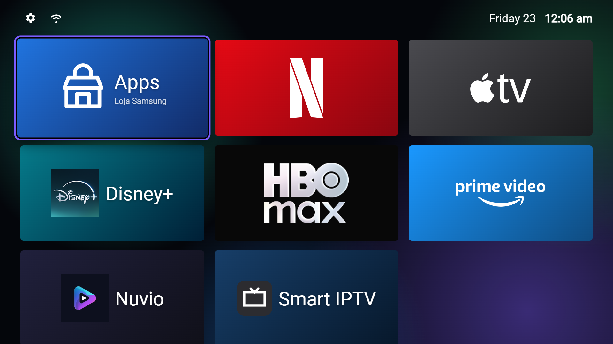

# AeroTizen TU8000

**Tela inicial limpa para Samsung Tizen, com inicialização automática ao ligar a TV.**

Adaptação de [AeroTizen, de Hamza El Alaoui](https://github.com/helalaou/AeroTizen),
**feita para a Samsung TU8000, testada e funcional na TV de LuizFLB**.
Modelo testado: **Samsung TU8000 — UN50TU8000GXZD (2020), Tizen 5.5**.
Versão do launcher: **2.0.7**.

A branch padrão desta edição é `tu8000`, baseada na versão adaptada e testada
na TV. A branch `main` herdada do projeto original contém outra linha de evolução.



## Inicializa junto com a TV

O pacote inclui um serviço Tizen com `on-boot`, que abre o AeroTizen automaticamente.
**Testado e funcional na TU8000:** o AeroTizen abre sozinho ao ligar a TV,
sem comando do computador, conforme confirmado pelo proprietário no uso real.
Depois de instalado, o computador não precisa ficar ligado.

**O atraso interno atual é de 1 segundo após o serviço iniciar.** A TV pode mostrar
a tela Samsung antes disso: o tempo que o firmware leva para iniciar o serviço
se soma a esse segundo. Na detecção de retorno de standby, o serviço usa uma espera
de 5 segundos. Não significa que a tela estará pronta 1 segundo após apertar Power.
Não foram validados todos os cenários de reinício, corte de energia ou firmware.

A inicialização usa certificado de distribuidor **Partner**, emitido pela Samsung
para a TV de destino. Um certificado Public sozinho não resolveu o autorun nesta
TU8000. A emissão Partner depende da aprovação/disponibilidade da Samsung para
cada conta e dispositivo; este repositório não fornece certificados privados.

## O que mudou nesta edição

- Loja Samsung Apps no lugar do cartão Fireplace.
- Lista de aplicativos com descoberta nativa, incluindo apps que antes não apareciam.
- Inventário inicial offline para evitar uma tela presa no carregamento.
- Logos locais de Disney+, HBO Max e Nuvio, vetores e símbolos para os demais apps.
- Alternativa de ícone com iniciais quando a imagem de um app não carrega.
- Layout compatível com o Chromium 69 da TU8000.
- Serviço de inicialização que observa energia e retomada, sem reabrir o launcher continuamente.
- Favoritos, organização de cartões, fundos, relógio, clima e entradas herdados do AeroTizen.

## Compatibilidade: TU8000 testada e funcional

**Esta edição foi feita especificamente para a Samsung TU8000 e está testada e
funcional nesse modelo.** Não é apenas uma candidata baseada na versão do Tizen.

| TV testada nesta edição | Ano | Sistema | Resultado |
|---|---|---|---|
| **Samsung TU8000 — UN50TU8000GXZD** | **2020** | **Tizen 5.5 / Chromium 69** | **Testada e funcional:** instalação, tela inicial, lista de apps, loja Samsung, logos e inicialização automática ao ligar. |

O detalhe da validação e do comportamento de inicialização está nas
[notas técnicas da TU8000](docs/TU8000.md). Outros tamanhos e variantes regionais
da TU8000 ainda não têm teste específico registrado nesta edição.

### Outros modelos já testados no AeroTizen original

Este projeto deriva do [AeroTizen original](https://github.com/helalaou/AeroTizen).
Além da TU8000 testada aqui, a comunidade do projeto de origem já registra os
seguintes modelos na [seção Tested on](https://github.com/helalaou/AeroTizen#tested-on):

| Modelo testado no projeto original | Ano | Tizen informado |
|---|---|---|
| Samsung 65" Crystal UHD DU7200 — UN65DU7200FXZA | 2024 | 9.0 |
| Samsung 65" The Frame LS03D — QE65LS03DAUXXU | 2024 | 9.0 |
| Samsung 65" OLED S90C — QE65S90CATXZT | 2023 | 7.0 |
| Samsung 75" QLED Q60B — QE75Q60BAUXXC | 2022 | 6.5 |

Fonte consultada em 24/10/2026. Esses são testes relatados do **AeroTizen original**;
a adaptação **TU8000 deste repositório** foi testada na TU8000. A relação mostra
os testes de ambos os projetos sem atribuir aos outros modelos um teste desta edição.
As funções e limitações podem diferir entre as versões; por exemplo, o original
ainda não confirma partida a frio na The Frame citada.

### Possíveis candidatas ainda sem teste registrado nesta edição

| Família | Situação |
|---|---|
| Outras TU8000, tamanhos ou regiões | Mesma família do modelo testado; precisa confirmar a variante. |
| TU7000 / TU8500 e QLED 2020, como Q60T / Q70T / Q80T | Possíveis candidatas por geração Tizen 5.5. |
| AU7000 / AU8000, BU8000, CU8000, DU7000 / DU8000 | Possíveis candidatas Tizen mais recentes; validar APIs e inicialização por modelo. |
| Samsung anteriores a 2020 | Fora do escopo testado desta edição. |
| LG webOS, Android TV, Google TV e Samsung sem Tizen | Esta versão não é destinada a esses sistemas. |

Apenas esta última lista de candidatas é uma **inferência de plataforma**.
Ano, região e firmware podem mudar o comportamento. Referência:
[grupos de modelos da Samsung](https://developer.samsung.com/smarttv/develop/specifications/tv-model-groups.html).
Relate modelo completo, região, Tizen e resultado de ligar/desligar em uma
[issue de compatibilidade](https://github.com/luizflb/AeroTizen-TU8000/issues/new?template=model_report.yml).

## Instalação passo a passo (Windows)

### 1. Prepare o computador

Instale [Python 3.10 ou mais recente](https://www.python.org/downloads/windows/)
com a opção **Add python.exe to PATH**, e [Git](https://git-scm.com/downloads/win).
Abra um novo PowerShell e confira:

```powershell
python --version
git --version
```

Se `python` não for encontrado, corrija a instalação/PATH antes de continuar.
Se apenas `py` funcionar, use `py` no lugar de `python` nos comandos abaixo.
Computador e TV devem estar na mesma rede.

### 2. Baixe esta edição e instale a ferramenta

```powershell
git clone https://github.com/luizflb/AeroTizen-TU8000.git
cd AeroTizen-TU8000
python -m pip install -e ".[dev]"
aerotizen discover
```

Use o IP da sua TV no lugar de `192.168.1.50` nos exemplos. O IP é apenas um exemplo.
Se `aerotizen` não for reconhecido, reabra o terminal e confira o diretório Scripts
na instalação do Python.

### 3. Ative o Modo Desenvolvedor

Na TV, abra **Apps** e digite **12345** com o controle ou teclado numérico virtual.
Ative **Developer Mode** e informe em **Host PC IP** o IP do computador, obtido
com `ipconfig` no PowerShell. Esse campo recebe o IP do PC, não o da TV.

Reinicie conforme a orientação da TV. No procedimento usado neste projeto, foi
necessário retirar da tomada por cerca de um minuto e ligar novamente.
Confira a conexão:

```powershell
aerotizen --tv 192.168.1.50 status
```

O resultado deve indicar `developerMode=1` e acesso SDB. O fluxo usa SDB/Tizen,
não ADB/Android. Não precisa de root.

### 4. Crie os certificados da sua TV

```powershell
aerotizen --tv 192.168.1.50 certs
```

Conclua o login na página oficial da Samsung aberta no navegador. Os certificados
são gerados localmente, vinculados ao identificador da sua TV. Guarde o certificado
de autor para poder atualizar a mesma instalação no futuro.

### 5. Habilite o certificado usado na inicialização automática

Primeiro obtenha a cadeia pública pela extensão oficial Samsung:

```powershell
python tools/fetch_partner_ca.py
python tools/enable_boot_certificate.py --tv 192.168.1.50
```

Conclua o novo login Samsung quando solicitado. O script pede um distribuidor
Partner, valida sua assinatura e preserva o autor. Os certificados anteriores
ficam em `public-backup`, no diretório privado de certificados.

**Continue somente se a emissão e a verificação terminarem com sucesso.** Se a
Samsung recusar a emissão, não há garantia de inicialização automática com este
procedimento. Não use certificados de outras pessoas e não envie `.p12`, senhas,
`device-profile.xml`, tokens ou pacotes assinados para issues.

### 6. Capture a lista de apps e instale

```powershell
python tools/tv_inventory.py --tv 192.168.1.50
aerotizen --tv 192.168.1.50 install launcher
```

A captura atualiza o inventário offline antes da assinatura. O pacote fornecido
no código usa um inventário de referência da TU8000; a descoberta nativa o
atualiza durante o uso. Cada pessoa assina o pacote para sua própria TV.

Abra **AeroTizen** pela lista de aplicativos da Samsung.

### 7. Ajuste a abertura ao ligar

Na TU8000: **Configurações → Geral → Funções Smart**:

- Ligue **Execução automática do último aplicativo**.
- Desligue **Execução automática do Smart Hub**.
- Desligue **Execução automática do Samsung TV Plus**, se essa opção existir.

Deixe o AeroTizen aberto, desligue normalmente pelo controle e ligue novamente.
Aguarde a inicialização do sistema e observe se a tela aparece automaticamente.
Repita o teste após usar outros apps. Em gerações mais novas, os nomes/caminhos
dessas opções podem ser diferentes.

## Uso e atualização

A engrenagem abre as configurações. Selecione os apps que deseja na tela inicial;
segure OK em um cartão para reorganizar. O cartão **Apps** abre a loja Samsung.
Os streamings continuam usando seus aplicativos e assinaturas habituais.

Para atualizar, preserve os certificados e execute na pasta do projeto:

```powershell
git pull
aerotizen --tv 192.168.1.50 install launcher
```

Para voltar à interface Samsung, pressione Home ou use a opção de voltar à tela
Samsung nas configurações do AeroTizen. Para remover definitivamente o serviço,
remova o pacote AeroTizen nas configurações de Apps; se permitido pelo firmware,
a remoção por SDB também é possível. Apenas sair do app não desativa o `on-boot`.

## Limites conhecidos

- É um aplicativo com serviço de inicialização; o Tizen e o destino do botão Home
  continuam sendo controlados pela Samsung.
- A abertura automática foi observada com atraso. Não há garantia de autorun em
  todos os firmwares ou em toda forma de desligamento.
- A espera inicial de 1 segundo não elimina o tempo de boot do sistema.
- Esta edição desativa o vigilante original que tentava recuperar a tela a partir
  de sinais de visibilidade: na TU8000 esses sinais causavam reaberturas em loop.
- Não remove anúncios dentro de Netflix, YouTube ou outros serviços.
- Nenhum app de sistema precisa ser removido para instalar este launcher.
- Não inclui filmes, canais IPTV, contas, assinaturas ou listas M3U.
- Logos de alguns apps são símbolos locais; um app desconhecido pode usar iniciais.

## Testes e detalhes técnicos

```powershell
npm install
npm run lint
node tools/verify-startup.cjs
python -m pytest
```

Para verificar a interface com Playwright, instale `playwright` separadamente
(`npm install --no-save playwright`), execute `npx playwright install chromium`
e rode `node tools/verify-launcher.cjs`. É possível indicar um Chrome instalado
com a variável `CHROME_EXECUTABLE`.

A validação de interface cobre os 16 apps de referência, logos locais, falhas de
ícone, loja e descoberta que demora a responder. O teste do serviço simula boot,
standby, retomada e cancelamento; não substitui testes físicos em outros modelos.
Veja [notas técnicas da TU8000](docs/TU8000.md).

## Créditos e licença

Adaptação TU8000 e testes: **LuizFLB**, com assistência de IA no desenvolvimento.
Base: **[AeroTizen — Hamza El Alaoui](https://github.com/helalaou/AeroTizen)**.
O histórico e a licença MIT originais foram preservados.

Demais créditos: [LTvLauncher](https://github.com/leanbitlab-org/LtvLauncher),
[Apps2Samsung](https://github.com/Apps2Samsung/Apps2Samsung),
[tizen-sdb](https://github.com/PatrickSt1991/tizen-sdb),
[Simple Icons](https://simpleicons.org), Open-Meteo e ipapi.
As fontes dos logos adicionais estão em [SOURCES.md](launcher/assets/apps/SOURCES.md).
Marcas pertencem aos respectivos titulares. Não há afiliação com Samsung ou os
serviços de streaming. [Licença MIT](LICENSE).
